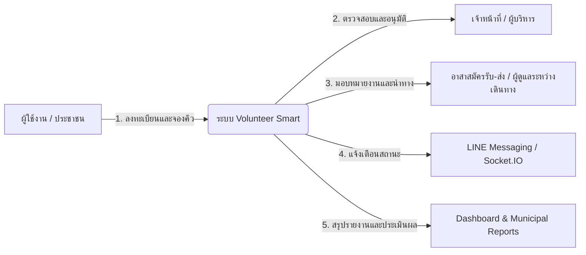
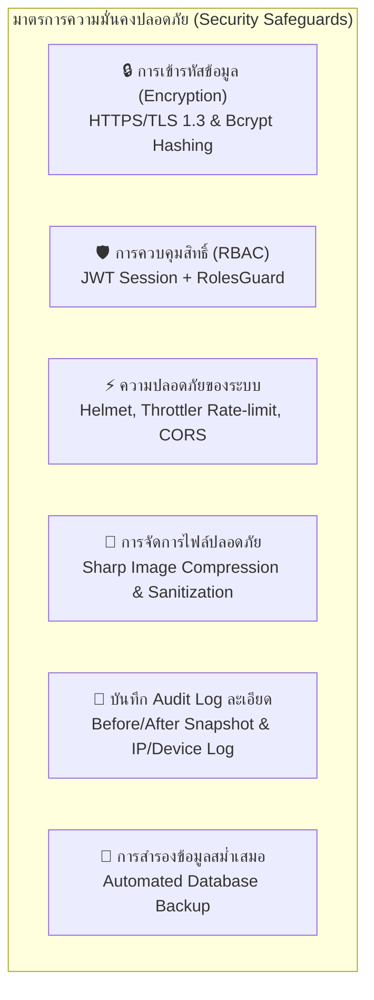

# ประกาศความเป็นส่วนตัว (Privacy Notice)
## ระบบบริหารจัดการอาสาสมัครรับ-ส่งประชาชนไปโรงพยาบาล (Volunteer Smart)

**วันที่มีผลบังคับใช้:** 1 กันยายน 2569  
**เวอร์ชัน:** 2.0  
**สถานะ:** มีผลบังคับใช้ (Active)

---

## 1. บทนำและขอบเขตการบังคับใช้ (Introduction & Scope)

ระบบ **Volunteer Smart** ("เรา", "ระบบของเรา" หรือ "ผู้ให้บริการ") ซึ่งพัฒนาและดำเนินการเพื่อสนับสนุนภารกิจการบริการสาธารณะและสวัสดิการสังคมขององค์กรปกครองส่วนท้องถิ่น (เทศบาล / องค์การบริหารส่วนตำบล) ในการอำนวยความสะดวกรับ-ส่งประชาชน ผู้สูงอายุ ผู้ป่วย และผู้มีภาวะพึ่งพิงไปยังสถานพยาบาล ตลอดจนการบริหารจัดการอาสาสมัคร ยานพาหนะ และทรัพยากรที่เกี่ยวข้อง

เราให้ความสำคัญอย่างยิ่งต่อความเป็นส่วนตัวและการคุ้มครองข้อมูลส่วนบุคคลของท่าน ประกาศความเป็นส่วนตัวฉบับนี้จัดทำขึ้นตาม **พระราชบัญญัติคุ้มครองข้อมูลส่วนบุคคล พ.ศ. 2562 (PDPA)** เพื่อแจ้งให้ผู้ใช้งานทุกกลุ่มทราบถึงรายละเอียด วัตถุประสงค์ ฐานทางกฎหมาย การประมวลผล ระยะเวลาการจัดเก็บ การเปิดเผยข้อมูล ตลอดจนสิทธิของท่านในฐานะเจ้าของข้อมูลส่วนบุคคล

ประกาศฉบับนี้มีผลครอบคลุมการใช้งานระบบ Volunteer Smart ผ่านทุกช่องทาง ได้แก่:
1. ระบบเว็บแอปพลิเคชัน (Web Application)
2. บริการเชื่อมต่อผ่าน LINE Platform (LINE Login, LINE LIFF และ LINE Messaging API)
3. ระบบยืนยันตัวตนภาครัฐ (IAM-GOV Single Sign-On)
4. การติดต่อสื่อสารและการประสานงานผ่านช่องทางดิจิทัลที่เกี่ยวข้องกับระบบ

---

## 2. บทบาทและกลุ่มผู้ใช้งานในระบบ (User Roles & Target Groups)

ระบบ Volunteer Smart มีการประมวลผลข้อมูลส่วนบุคคลของบุคคลตามบทบาทหน้าที่ในระบบ ดังนี้:

| กลุ่มผู้ใช้งานในระบบ | คำอธิบายและหน้าที่ |
| :--- | :--- |
| **ประชาชน / ผู้สูงอายุ / ผู้รับบริการ** | ประชาชนทั่วไป ผู้สูงอายุ หรือผู้ป่วยที่ลงทะเบียนเพื่อขอรับบริการจองคิวรับ-ส่งไปโรงพยาบาล |
| **ผู้ดูแลประชาชน** | ญาติหรือผู้แทนที่ได้รับมอบหมายในการจัดการข้อมูล ลงทะเบียน และจองคิวแทนประชาชนในความดูแล |
| **อาสาสมัครขับรถ** | อาสาสมัครผู้ทำหน้าที่ขับขี่ยานพาหนะเพื่อรับ-ส่งประชาชนตามงานที่ได้รับมอบหมาย |
| **ผู้ดูแลระหว่างเดินทาง** | อาสาสมัครหรือผู้ช่วยพยาบาลที่ร่วมเดินทางเพื่อดูแลความปลอดภัยและสุขภาพของผู้ป่วย |
| **เจ้าหน้าที่** | บุคลากรขององค์กรปกครองส่วนท้องถิ่นที่ทำหน้าที่ตรวจสอบเอกสาร อนุมัติคำขอ จัดสรรงาน และบริหารระบบ |
| **ผู้บริหาร** | ผู้บริหารองค์กรปกครองส่วนท้องถิ่นที่มีอำนาจอนุมัติคำขอในระดับนโยบายและการจัดสรรทรัพยากร |
| **ผู้ดูแลระบบ** | ผู้ดูแลความมั่นคงปลอดภัย สิทธิ์การเข้าถึง และการทำงานเชิงเทคนิคของระบบ |

---

## 3. ข้อมูลส่วนบุคคลที่เราเก็บรวบรวม (Categories of Personal Data Collected)

ระบบ Volunteer Smart จัดเก็บและประมวลผลข้อมูลส่วนบุคคลเท่าที่จำเป็นตามวัตถุประสงค์การให้บริการ โดยแบ่งออกเป็นหมวดหมู่ดังต่อไปนี้:

### 3.1 ข้อมูลส่วนบุคคลทั่วไป (General Personal Data)

#### ก. ข้อมูลประชาชน / ผู้สูงอายุ / ผู้รับบริการ
- **ข้อมูลระบุตัวตน:** คำนำหน้าชื่อ, ชื่อ-นามสกุล, เพศ, วัน/เดือน/ปีเกิด, เลขประจำตัวประชาชน 13 หลัก (`idCard`), รูปถ่ายโปรไฟล์ (`pictureUrl`), รหัสบัญชีผู้ใช้ภาครัฐ (`iamUserId`)
- **ข้อมูลการติดต่อ:** หมายเลขโทรศัพท์ที่ติดต่อได้ (`phone`), ชื่อผู้ติดต่อฉุกเฉิน/ญาติ (`relativeName`), หมายเลขโทรศัพท์ฉุกเฉิน (`relativePhone`)
- **ข้อมูลที่อยู่อาศัยและพิกัด:** บ้านเลขที่, หมู่, ซอย, ถนน, ชุมชน/หมู่บ้าน, ตำบล, อำเภอ, จังหวัด, รหัสไปรษณีย์, รายละเอียดจุดสังเกตที่อยู่ (`addressDetail`), พิกัดตำแหน่งที่อยู่อาศัยบนแผนที่ (Latitude, Longitude)
- **ข้อมูลการยืนยันที่พักอาศัย:** ข้อมูลการยื่นคำร้องขอรับรองที่อยู่อาศัยในเขตท้องถิ่น (`ResidenceClaim`) และข้อมูลที่อยู่อาศัยที่เชื่อมโยงกับฐานข้อมูลทะเบียนราษฎร์ภาครัฐ (`IamUserResidence`)
- **ข้อมูลการใช้งานและประวัติบริการ:** ประวัติการจองคิวรับ-ส่ง, ประวัติการเดินทาง, สถานะคำขอ, วันเวลาที่กดยืนยันงาน, ข้อมูลการให้คะแนนและข้อเสนอแนะการบริการ (`MunicipalRating`)

#### ข. ข้อมูลผู้ดูแลประชาชน
- **ข้อมูลส่วนตัวและการติดต่อ:** ชื่อ-นามสกุล, เพศ, วันเกิด, เลขบัตรประชาชน, หมายเลขโทรศัพท์, ที่อยู่, พิกัดที่อยู่อาศัย, รูปโปรไฟล์
- **ข้อมูลความสัมพันธ์และการเป็นตัวแทน:** ความสัมพันธ์กับผู้ป่วย (`FAMILY`, `RELATIVE`, `CLOSE_PERSON`), รายละเอียดความสัมพันธ์เพิ่มเติม (`additionalDetails`), ภาพถ่ายเอกสารยืนยันความสัมพันธ์หรือหนังสือมอบอำนาจ (`documentUrl`), ประวัติการยื่นคำขอและการอนุมัติสถานะผู้ดูแล (`CaregiverPatient`)
- **ข้อมูลการทำรายการแทน:** ประวัติการลงทะเบียนและจองคิวแทนประชาชนในความดูแล (`Queue.createdBy`)

#### ค. ข้อมูลอาสาสมัครขับรถ
- **ข้อมูลส่วนตัว:** ชื่อ-นามสกุล, เพศ, วันเกิด, เลขบัตรประชาชน, หมายเลขโทรศัพท์, รูปถ่ายโปรไฟล์
- **ข้อมูลยานพาหนะและการปฏิบัติงาน:** ทะเบียนรถ, ยี่ห้อ, รุ่น, สี, ประเภทรถ, ประเภทน้ำมันเชื้อเพลิง (`fuelType`), ภาพถ่ายรถยนต์, ข้อมูลบันทึกเลขไมล์ก่อนและหลังเดินทาง (`VehicleMileageLog`), ภาพถ่ายหลักฐานการนำรถกลับสำนักงาน/จุดจอด (`returnEvidenceUrl`)
- **ข้อมูลการปฏิบัติงานและผลตอบแทน:** ประวัติการรับงาน/ปฏิเสธงาน, เวลาเริ่มและสิ้นสุดภารกิจ, ระยะทางรวม (`distanceKm`), คะแนนประเมินจากผู้รับบริการ (`ratingScore`, `ratingComment`), คะแนนสะสม (`pointsBalance`), ประวัติแต้มที่ได้รับ (`earnedPoints`), ประวัติการขอแลกของรางวัล (`Redemption`)

#### ง. ข้อมูลผู้ดูแลระหว่างเดินทาง
- **ข้อมูลส่วนตัว:** ชื่อ-นามสกุล, เพศ, วันเกิด, เลขบัตรประชาชน, หมายเลขโทรศัพท์, รูปถ่ายโปรไฟล์
- **ข้อมูลการปฏิบัติงาน:** ประวัติการร่วมเดินทางดูแลผู้ป่วย, เวลาที่ปฏิบัติภารกิจ, คะแนนประเมินและข้อคิดเห็นจากผู้รับบริการ (`careuRatingScore`, `careuRatingComment`), คะแนนสะสมและการแลกของรางวัล

#### จ. ข้อมูลเจ้าหน้าที่และผู้บริหาร
- **ข้อมูลส่วนตัวและการทำงาน:** ชื่อ-นามสกุล, หมายเลขโทรศัพท์, สังกัดหน่วยงาน/องค์กรปกครองส่วนท้องถิ่น (`organizationId`), สิทธิ์และบทบาทหน้าที่
- **บันทึกการปฏิบัติราชการ:** บันทึกการตรวจสอบคำขอ, บันทึกการอนุมัติ/ปฏิเสธคิว (`verifiedBy`, `verifiedAt`), บันทึกการอนุมัติระดับผู้บริหาร (`executiveApprovedBy`, `executiveApprovedAt`), บันทึกการตรวจสอบผู้ดูแล, บันทึกการอนุมัติแก้ไขโปรไฟล์, บันทึกการปรับปรุงสต็อกของรางวัลและหลักฐานแนบ (`RewardStockHistory.evidenceUrl`)

#### ฉ. ข้อมูลคำขอเปลี่ยนบทบาทและแก้ไขข้อมูล
- **คำขอเปลี่ยนบทบาท (`RoleRequest`):** บทบาทเดิม, บทบาทที่ร้องขอ, เหตุผลความจำเป็น, เอกสารหรือใบอนุญาตประกอบ (`documents`), ผลการพิจารณา
- **คำขอแก้ไขโปรไฟล์ (`ProfileEditRequest`):** ข้อมูลที่ต้องการเปลี่ยนแปลง, ภาพถ่ายหรือหลักฐานใหม่, เหตุผลและบันทึกผลการตรวจสอบ

---

### 3.2 ข้อมูลส่วนบุคคลที่มีความอ่อนไหว (Sensitive Personal Data)

ตามมาตรา 26 แห่ง พ.ร.บ. คุ้มครองข้อมูลส่วนบุคคล พ.ศ. 2562 ระบบมีการเก็บรวบรวมข้อมูลที่มีความอ่อนไหวเป็นพิเศษเพื่อประโยชน์ในการดูแลความปลอดภัยและจัดบริการรับ-ส่งทางการแพทย์ที่เหมาะสม ดังนี้:

- **ข้อมูลสุขภาพและโรคประจำตัว (Health Data):** รายการโรคประจำตัวตามฐานข้อมูลมาตรฐาน (`Disease`) และโรคประจำตัวที่ระบุเพิ่มเติม (`customDiseases`)
- **ข้อมูลภาวะการเคลื่อนไหว (Mobility Status):** ภาวะการเคลื่อนไหวของผู้ป่วย ได้แก่ เดินได้ปกติ (`WALKING`), ใช้วีลแชร์ (`WHEELCHAIR`), หรือผู้ป่วยติดเตียง (`BEDRIDDEN`)
- **ข้อมูลความต้องการพิเศษและอุปกรณ์ทางการแพทย์:** ความต้องการพิเศษระหว่างเดินทาง (`specialNeeds`), รายการอุปกรณ์เสริมที่จำเป็น (`requiredEquipment` เช่น ถังออกซิเจน, เปลพยาบาล, วีลแชร์)
- **ข้อมูลใบนัดหมายแพทย์และประวัติการรักษา:** ภาพถ่ายใบนัดตรวจของแพทย์ (`appointmentImage`), ข้อมูลโรงพยาบาลปลายทาง (`Hospital`), แผนก/คลินิกที่นัดตรวจ (`department`), วันและเวลาที่นัดหมาย
- **ระดับความเร่งด่วน/ความรุนแรงทางการแพทย์ (Triage Severity Level):** ระดับสีเขียว (`GREEN` - ทั่วไป), สีเหลือง (`YELLOW` - เฝ้าระวัง/มีภาวะแทรกซ้อน), หรือสีแดง (`RED` - ต้องการการดูแลใกล้ชิด)

> [!IMPORTANT]
> **การเก็บรวบรวมข้อมูลสุขภาพและข้อมูลที่มีความอ่อนไหว:** ระบบจะขอความยินยอมโดยชัดแจ้ง (Explicit Consent) จากท่านก่อนทำการบันทึกข้อมูล และจะนำข้อมูลดังกล่าวไปใช้เฉพาะเพื่อการจัดเตรียมยานพาหนะ จัดสรรอาสาสมัครที่มีทักษะเหมาะสม และการดูแลความปลอดภัยในชีวิตและสุขภาพของท่านเท่านั้น

---

### 3.3 ข้อมูลตำแหน่งและการติดตามแบบเรียลไทม์ (Real-time GPS Tracking Data)

- **พิกัดตำแหน่งเรียลไทม์ขณะเดินทาง (`JobLocationLog`):** ค่าพิกัดละติจูด (Latitude) และลองจิจูด (Longitude) ของอาสาสมัครขับรถ พร้อมบันทึกเวลา (Timestamp) ตลอดช่วงเวลาที่เริ่มปฏิบัติภารกิจรับ-ส่ง จนกระทั่งนำส่งผู้ป่วยถึงโรงพยาบาล/กลับถึงที่พัก และส่งคืนยานพาหนะ
- **วัตถุประสงค์:** เพื่อแสดงตำแหน่งรถบนแผนที่ให้ผู้ป่วย/ผู้ดูแล/เจ้าหน้าที่ติดตามความคืบหน้าแบบเรียลไทม์ เพื่อความปลอดภัยในกรณีเกิดเหตุฉุกเฉิน และเพื่อตรวจสอบความถูกต้องของเส้นทางและระยะทางจริง

---

### 3.4 ข้อมูลจากการเชื่อมต่อระบบภายนอก (Third-Party Integrations & SSO)

- **LINE Platform (LINE Login / LINE LIFF / LINE Messaging API):** LINE User ID, ชื่อที่แสดง (Display Name), รูปโปรไฟล์ LINE, ข้อความโต้ตอบ และ Token สำหรับส่งข้อความแจ้งเตือนสถานะงาน
- **ระบบยืนยันตัวตนภาครัฐ (IAM-GOV SSO):** IAM User ID, สถานะการตรวจสอบตัวตน และข้อมูลการเชื่อมโยงทะเบียนราษฎร์ในเขตพื้นที่
- **บริการแผนที่และแปลงพิกัด (Mapbox, OpenStreetMap, Geocoding Service):** ข้อมูลพิกัดและที่อยู่เพื่อใช้ในการแปลงเป็นแผนที่ เส้นทางการเดินทาง และการประมาณระยะทาง

---

### 3.5 ข้อมูลทางเทคนิคและบันทึกการใช้งาน (Technical & Activity Logs)

- **ข้อมูลอุปกรณ์และการเชื่อมต่อ:** หมายเลข IP Address, ชนิดและเวอร์ชันของ Web Browser, ระบบปฏิบัติการ (OS), ชนิดของอุปกรณ์ (Device Type)
- **คุกกี้และโทเคน (Cookies & Tokens):** Access Token (JWT), Refresh Token เพื่อการรักษาความปลอดภัยของเซสชันการเข้าสู่ระบบ
- **บันทึกกิจกรรมในระบบ (`ActivityLog`):** บันทึกการกระทำของผู้ใช้ในระบบ ได้แก่ หมวดหมู่กิจกรรม (`ActivityCategory`: `AUTH`, `QUEUE`, `JOB`, `CAREGIVER`, `USER`, `VEHICLE`, `REWARD`, `SETTING`, `RESIDENCE`), รหัสรายการ, ค่าก่อนและหลังการเปลี่ยนแปลง (Before/After JSON snapshot), ผลการดำเนินการ (สำเร็จ/ล้มเหลว), วันเวลา และ IP Address

---

## 4. วัตถุประสงค์ในการเก็บรวบรวม ใช้ และเปิดเผยข้อมูลส่วนบุคคล (Purposes of Processing)

เราประมวลผลข้อมูลส่วนบุคคลของท่านภายใต้วัตถุประสงค์ที่กำหนดไว้อย่างชัดเจน ดังนี้:



1. **การให้บริการรับ-ส่งประชาชนไปโรงพยาบาล (Core Service Delivery):**
   - จัดการคำขอจองคิว ตรวจสอบความถูกต้องของข้อมูลใบนัดหมายแพทย์ และจัดสรรช่วงเวลา (Booking Time Slot)
   - จัดเตรียมยานพาหนะ อุปกรณ์เสริมทางการแพทย์ (เช่น ออกซิเจน, วีลแชร์) ให้สอดคล้องกับภาวะสุขภาพของผู้ป่วย
   - จับคู่และมอบหมายอาสาสมัครขับรถ และผู้ดูแลระหว่างเดินทาง
2. **การติดตามสถานะและความปลอดภัยในการเดินทาง (Real-time Tracking & Safety):**
   - แสดงตำแหน่งยานพาหนะแบบเรียลไทม์บนแผนที่สำหรับผู้ป่วย ผู้ดูแล และศูนย์ควบคุมของเจ้าหน้าที่
   - บันทึกเส้นทางและเวลาในการเดินทาง เพื่อความปลอดภัยและกรณีเกิดอุบัติเหตุหรือเหตุฉุกเฉิน
3. **การยืนยันตัวตนและการตรวจสอบสิทธิ์ (Identity Verification & Access Control):**
   - ยืนยันตัวตนผ่าน LINE Login หรือ IAM-GOV SSO
   - ตรวจสอบสิทธิ์การเป็นผู้ดูแลประชาชน (`Caregiver Verification`) ด้วยเอกสารหลักฐาน
   - ตรวจสอบภูมิลำเนาและสิทธิการรับบริการในเขตพื้นที่องค์กรปกครองส่วนท้องถิ่น (`Residence Claim`)
4. **การบริหารจัดการและการอนุมัติภายในองค์กร (Administrative & Governance):**
   - การพิจารณาอนุมัติคำขอคิวโดยเจ้าหน้าที่และผู้บริหารท้องถิ่น
   - การจัดการยานพาหนะ บันทึกเลขไมล์ และการบำรุงรักษา
   - การจัดทำรายงานสถิติ รายงานการปฏิบัติงาน และรายงานการเบิกจ่ายงบประมาณราชการ
5. **การแจ้งเตือนและการติดต่อสื่อสาร (Notifications & Communication):**
   - แจ้งเตือนสถานะคำขอ (อนุมัติ / มอบหมายงาน / รถออกเดินทาง / ถึงจุดหมาย) ผ่าน LINE Messaging API และ Socket.IO
   - ติดต่อประสานงานระหว่างผู้ป่วย ผู้ดูแล อาสาสมัคร และเจ้าหน้าที่
6. **ระบบคะแนนสะสมและของรางวัลสำหรับอาสาสมัคร (Points & Rewards):**
   - คำนวณคะแนนตอบแทนความดีจากการปฏิบัติงานรับ-ส่ง
   - จัดการการแลกของรางวัล และการตรวจนับคลังสต็อกของรางวัล
7. **การประเมินคุณภาพและการพัฒนาการบริการ (Quality & Feedback Evaluation):**
   - รวบรวมผลการประเมินความพึงพอใจการให้บริการของเทศบาล (`MunicipalRating`) ใน 6 มิติหลัก (ความตรงต่อเวลา, ความสะดวกในการจอง, ความสะอาด, ความปลอดภัย, ความเอาใจใส่, ความพึงพอใจโดยรวม)
   - รวบรวมคะแนนรีวิวการทำงานของอาสาสมัครเพื่อพัฒนาคุณภาพการบริการ
8. **การรักษาความมั่นคงปลอดภัยและการตรวจสอบย้อนหลัง (Security & Audit Trail):**
   - บันทึก Activity Log เพื่อป้องกันการเข้าถึงโดยมิชอบ การทุจริต หรือการแก้ไขข้อมูลโดยไม่ได้รับอนุญาต
9. **การปฏิบัติตามกฎหมายและระเบียบราชการ (Legal Obligations):**
   - การจัดเก็บข้อมูลตามระเบียบงานสารบรรณ ระเบียบการเงินการคลังภาครัฐ และกฎหมายคุ้มครองข้อมูลส่วนบุคคล

---

## 5. ฐานทางกฎหมายในการประมวลผลข้อมูลส่วนบุคคล (Lawful Bases for Processing)

เราประมวลผลข้อมูลส่วนบุคคลของท่านโดยอาศัยฐานทางกฎหมายตามมาตรา 24 และมาตรา 26 แห่ง พ.ร.บ. คุ้มครองข้อมูลส่วนบุคคล พ.ศ. 2562 ดังต่อไปนี้:

| ประเภทข้อมูล | กิจกรรมการประมวลผล | ฐานทางกฎหมายหลัก (Lawful Basis) |
| :--- | :--- | :--- |
| **ข้อมูลสุขภาพ, ภาวะการเคลื่อนไหว, ภาพใบนัด** | ประเมินความต้องการทางการแพทย์, จัดสรรรถและอุปกรณ์ | **ความยินยอมโดยชัดแจ้ง (Explicit Consent)** ตามมาตรา 26 |
| **ข้อมูลตำแหน่ง GPS เรียลไทม์** | แสดงตำแหน่งรถสดเพื่อความปลอดภัยขณะปฏิบัติงาน | **ความยินยอมโดยชัดแจ้ง (Explicit Consent)** ตามมาตรา 26 / สัญญา |
| **ข้อมูลเอกสารยืนยันตัวตนและความสัมพันธ์** | ตรวจสอบสิทธิ์ผู้ดูแล / อาสาสมัคร | **ความยินยอม (Consent)** / ปฏิบัติตามคำขอ |
| **ข้อมูลบัญชีผู้ใช้, การจองคิว, การมอบหมายงาน** | ดำเนินการตามคำขอจองคิวและการให้บริการรับ-ส่ง | **การปฏิบัติตามสัญญา / การดำเนินการตามคำขอ (Contract Performance)** ตามมาตรา 24(3) |
| **การจัดบริการสาธารณะขององค์กรปกครองส่วนท้องถิ่น** | บริหารจัดการสวัสดิการสังคมและบริการสาธารณะ | **การปฏิบัติหน้าที่ในการดำเนินภารกิจเพื่อประโยชน์สาธารณะ (Public Task / Official Authority)** ตามมาตรา 24(4) |
| **Activity Log, การป้องกันการทุจริต, ความปลอดภัยระบบ** | บันทึกความเคลื่อนไหว, ตรวจสอบระบบ, ป้องกันภัยคุกคาม | **ประโยชน์โดยชอบด้วยกฎหมาย (Legitimate Interests)** ตามมาตรา 24(5) |
| **รายงานการปฏิบัติงาน, บันทึกการเงิน/เบิกจ่าย** | จัดเก็บหลักฐานตามระเบียบราชการและกฎหมายตรวจสอบ | **การปฏิบัติตามกฎหมาย (Legal Obligations)** ตามมาตรา 24(6) |

---

## 6. การเปิดเผยข้อมูลส่วนบุคคลและการมองเห็นข้อมูลข้ามบทบาท (Data Disclosure & Cross-Role Visibility)

เพื่อความโปร่งใส ระบบมีการจำกัดสิทธิ์การเข้าถึงข้อมูลตามบทบาทหน้าที่ (Principle of Least Privilege) โดยมีโครงสร้างการมองเห็นข้อมูล ดังนี้:

### 6.1 เมทริกซ์การเข้าถึงข้อมูลระหว่างผู้ใช้งานภายในระบบ (Data Visibility Matrix)

```
[ตารางสิทธิ์การมองเห็นข้อมูลระหว่างบทบาท]
+-------------------------------+---------------+---------------+---------------+---------------+---------------+
| ข้อมูล / บทบาทผู้ดู          | ประชาชน       | ผู้ดูแล        | อาสาสมัครขับรถ | เจ้าหน้าที่    | ผู้บริหาร       |
+-------------------------------+---------------+---------------+---------------+---------------+---------------+
| ข้อมูลผู้ป่วย & โรค/อุปกรณ์   | ดูเฉพาะของตน  | ดูของคนในดูแล | ดูเฉพาะงานที่รับ| ดูได้ทั้งหมด  | ดูได้ทั้งหมด   |
| พิกัดที่อยู่รับ-ส่ง           | ดูเฉพาะของตน  | ดูของคนในดูแล | ดูเฉพาะงานที่รับ| ดูได้ทั้งหมด  | ดูได้ทั้งหมด   |
| ข้อมูลคนขับ/ทะเบียนรถ        | ดูเมื่องานรับแล้ว| ดูเมื่องานรับแล้ว| ดูของตนเอง    | ดูได้ทั้งหมด  | ดูได้ทั้งหมด   |
| พิกัด GPS รถแบบเรียลไทม์      | ดูขณะเดินทาง  | ดูขณะเดินทาง  | ส่งพิกัดของตน  | ดูเพื่อมอนิเตอร์| ดูเพื่อมอนิเตอร์|
| เอกสารยืนยันตัวตน/ความสัมพันธ์ | ดูเฉพาะของตน  | ดูเฉพาะของตน  | ไม่สามารถดูได้| ตรวจสอบอนุมัติ| ตรวจสอบอนุมัติ|
| คะแนนสะสม/ของรางวัลอาสาสมัคร  | ไม่สามารถดูได้| ไม่สามารถดูได้| ดูเฉพาะของตน  | บริหารสต็อก   | ดูภาพรวม      |
| Activity Logs และ Audit Trail | ไม่สามารถดูได้| ไม่สามารถดูได้| ไม่สามารถดูได้| ดูตามสิทธิ์   | ดูตามสิทธิ์   |
+-------------------------------+---------------+---------------+---------------+---------------+---------------+
```

- **อาสาสมัครขับรถ และผู้ดูแลระหว่างเดินทาง:** จะมองเห็นเฉพาะข้อมูลชื่อ-นามสกุล, เบอร์โทรศัพท์, จุดรับ-ส่ง, ข้อมูลโรค/ภาวะเคลื่อนไหว, และอุปกรณ์ที่จำเป็นของประชาชนใน **งานที่ตนได้รับมอบหมายเท่านั้น** และไม่สามารถเข้าถึงประวัติอื่นที่ไม่เกี่ยวข้องได้
- **ประชาชน และผู้ดูแลประชาชน:** จะมองเห็นชื่อ เบอร์โทรศัพท์ รูปถ่าย ข้อมูลยานพาหนะ และพิกัดตำแหน่งสดของอาสาสมัครที่กำลังเดินทางมารับ-ส่ง
- **เจ้าหน้าที่ และผู้บริหาร:** สามารถเข้าถึงข้อมูลคำขอ ข้อมูลผู้ใช้งาน และข้อมูลการเดินทาง เพื่อการตรวจสอบ อนุมัติ มอบหมาย และทำรายงานราชการ
- **ผู้ดูแลระบบ:** เข้าถึงข้อมูลเชิงเทคนิคและบันทึกการใช้งานเพื่อการบำรุงรักษาความมั่นคงปลอดภัยระบบ

---

### 6.2 การเปิดเผยข้อมูลแก่ผู้ให้บริการภายนอก (Third-Party Disclosures)

เราอาจเปิดเผยข้อมูลส่วนบุคคลแก่ผู้ให้บริการภายนอกเท่าที่จำเป็นภายใต้สัญญาประมวลผลข้อมูลส่วนบุคคล (Data Processing Agreement):

1. **LINE Corporation / LY Corporation:** เพื่อให้บริการระบบยืนยันตัวตน (LINE Login), เว็บแอปผ่าน LINE (LIFF) และระบบส่งข้อความแจ้งเตือน (LINE Messaging API)
2. **ระบบ IAM-GOV (ศูนย์กลางบริการยืนยันตัวตนภาครัฐ):** เพื่อยืนยันตัวตนและตรวจสอบสิทธิการอยู่อาศัยในท้องถิ่น
3. **ผู้ให้บริการแผนที่ (Mapbox Inc. / OpenStreetMap Contributors):** เพื่อการแสดงผลแผนที่ การคำนวณเส้นทาง และการแปลงพิกัดที่อยู่
4. **ผู้ให้บริการคลาวด์และศูนย์ข้อมูล (Cloud Infrastructure & Database Hosting):** เพื่อการจัดเก็บข้อมูลและการประมวลผลระบบอย่างปลอดภัย
5. **สถานพยาบาลปลายทางหรือหน่วยแพทย์ฉุกเฉิน (EMS/1669):** ในกรณีเกิดอุบัติเหตุหรือเหตุฉุกเฉินทางการแพทย์ระหว่างการเดินทาง
6. **หน่วยงานราชการหรือหน่วยงานตรวจสอบตามกฎหมาย:** เช่น สตง., ป.ป.ช., หรือศาล เมื่อมีคำสั่งตามกฎหมาย

---

## 7. มาตรการรักษาความมั่นคงปลอดภัยของข้อมูลส่วนบุคคล (Data Security Measures)

เรามีมาตรการรักษาความมั่นคงปลอดภัยทั้งทางเทคนิค กายภาพ และการบริหารจัดการ ตามมาตรฐานสากลและมาตรา 37 แห่ง PDPA:



### 7.1 มาตรการทางเทคนิค (Technical Measures)
- **การเข้ารหัสข้อมูลขณะส่งผ่าน (Encryption in Transit):** ใช้โปรโตคอล HTTPS (TLS 1.2/1.3) สำหรับการสื่อสารและส่งข้อมูลทั้งหมด
- **การเข้ารหัสข้อมูลสำคัญ (Data Protection & Hashing):** รหัสผ่าน โทเคน และข้อมูลที่มีความอ่อนไหวถูกเข้ารหัสผ่านอัลกอริทึมมาตรฐานความปลอดภัยสูง (Bcrypt)
- **การควบคุมการเข้าถึงตามบทบาท (Role-Based Access Control - RBAC):** มีการตรวจสอบสิทธิ์ในทุก Endpoint ของระบบ (`JwtAuthGuard`, `RolesGuard`)
- **การป้องกันการโจมตีทางเว็บ:** ติดตั้ง Security Headers ด้วย Helmet, ระบบจำกัดจำนวนคำขอ (Rate Limiting / Throttler) เพื่อป้องกัน Brute-force / DDoS, และการตั้งค่า CORS อย่างรัดกุม
- **การประมวลผลไฟล์อัปโหลดอย่างปลอดภัย:** ไฟล์ภาพทั้งหมดผ่านการบีบอัด ล้าง EXIF Metadata ที่อาจมีข้อมูลพิกัดส่วนตัวที่ไม่จำเป็น และตรวจสอบชนิดไฟล์ด้วย Sharp Library ก่อนจัดเก็บ

### 7.2 มาตรการทางกายภาพและการบริหารจัดการ (Organizational & Physical Measures)
- จัดเก็บฐานข้อมูลบน Cloud Server ที่ได้รับมาตรฐานความปลอดภัยระดับสากล (ISO/IEC 27001, SOC 2)
- มีการจำกัดสิทธิ์การเข้าถึงเซิร์ฟเวอร์เฉพาะผู้ดูแลระบบที่ได้รับอนุญาตผ่านระบบยืนยันตัวตนสองชั้น (2FA)
- มีการจัดอบรมสร้างความตระหนักรู้ด้านการคุ้มครองข้อมูลส่วนบุคคลและจริยธรรมแก่อาสาสมัครและเจ้าหน้าที่ผู้ปฏิบัติงาน
- มีการตรวจสอบ Activity Log และทบทวนสิทธิ์การเข้าถึงอย่างสม่ำเสมอ

---

## 8. ระยะเวลาในการเก็บรักษาข้อมูลส่วนบุคคล (Data Retention Periods)

เราจะเก็บรักษาข้อมูลส่วนบุคคลของท่านตามระยะเวลาที่จำเป็นต่อการให้บริการและการปฏิบัติตามกฎหมาย/ระเบียบราชการ ดังนี้:

| ประเภทข้อมูล | ระยะเวลาการจัดเก็บ | เหตุผลและความจำเป็น |
| :--- | :--- | :--- |
| **ข้อมูลบัญชีผู้ใช้และโปรไฟล์** | ตลอดระยะเวลาที่บัญชียังใช้งาน + **2 ปี** หลังปิดบัญชี | เพื่อรองรับการกลับมาใช้บริการหรือการตรวจสอบย้อนหลัง |
| **ประวัติการจองคิวและการเดินทาง** | **5 - 10 ปี** นับแต่วันเสร็จสิ้นภารกิจ | ตามระเบียบงานสารบรรณและการตรวจสอบการเงินการคลังภาครัฐ |
| **ข้อมูลสุขภาพและภาพใบนัดหมาย** | **5 ปี** นับแต่วันที่สิ้นสุดการให้บริการ | เพื่อประโยชน์ทางการแพทย์และการติดตามประวัติการรักษา |
| **พิกัด GPS แบบเรียลไทม์ (`JobLocationLog`)** | **90 วัน** หลังเสร็จสิ้นภารกิจ | เพื่อการตรวจสอบเส้นทางกรณีมีข้อพิพาท/ร้องเรียน (เว้นแต่มีคดีความ) |
| **คะแนนสะสมและประวัติแลกของรางวัล** | **3 ปี** นับแต่วันที่ทำรายการ | เพื่อการตรวจนับพัสดุและสต็อกของรางวัลประจำปีงบประมาณ |
| **ผลการประเมินความพึงพอใจ (`Ratings`)** | **3 ปี** | เพื่อการวิเคราะห์สถิติและการพัฒนาคุณภาพการบริการ |
| **บันทึกกิจกรรมระบบ (`ActivityLog`)** | **1 - 2 ปี** | ตาม พ.ร.บ. ว่าด้วยการกระทำความผิดเกี่ยวกับคอมพิวเตอร์ฯ |

เมื่อพ้นกำหนดระยะเวลาดังกล่าวข้างต้น เราจะดำเนินการ **ลบ ทำลาย หรือทำให้ข้อมูลส่วนบุคคลกลายเป็นข้อมูลที่ไม่สามารถระบุตัวบุคคลได้ (Anonymization)** ภายในระยะเวลาไม่เกิน 30 วัน

---

## 9. สิทธิของเจ้าของข้อมูลส่วนบุคคล (Data Subject Rights)

ตามพระราชบัญญัติคุ้มครองข้อมูลส่วนบุคคล พ.ศ. 2562 ท่านมีสิทธิเกี่ยวกับข้อมูลส่วนบุคคลของท่าน ดังนี้:

1. **สิทธิในการขอเข้าถึงและรับสำเนา (Right of Access):** ท่านสามารถขอเข้าถึงและขอรับสำเนาข้อมูลส่วนบุคคลของท่านที่อยู่ในความรับผิดชอบของเรา
2. **สิทธิในการขอแก้ไขข้อมูลให้ถูกต้อง (Right to Rectification):** ท่านสามารถตรวจสอบและแก้ไขข้อมูลส่วนตัวของท่านให้ถูกต้อง เป็นปัจจุบัน และสมบูรณ์ ผ่านหน้าการตั้งค่าโปรไฟล์ หรือยื่นคำขอแก้ไขโปรไฟล์ (`Profile Edit Request`)
3. **สิทธิในการขอลบหรือทำลายข้อมูล (Right to Erasure / Right to be Forgotten):** ท่านมีสิทธิขอให้ลบ ทำลาย หรือทำให้ข้อมูลไม่สามารถระบุตัวตนได้ หากข้อมูลหมดความจำเป็น หรือท่านถอนความยินยอม
4. **สิทธิในการขอให้ระงับการใช้ข้อมูล (Right to Restriction of Processing):** ท่านมีสิทธิขอให้ระงับการประมวลผลข้อมูลชั่วคราวในระหว่างการตรวจสอบความถูกต้องหรือการคัดค้าน
5. **สิทธิในการขอรับหรือโอนย้ายข้อมูล (Right to Data Portability):** ท่านมีสิทธิขอรับข้อมูลส่วนบุคคลของท่านในรูปแบบที่เครื่องมือหรืออุปกรณ์สามารถอ่านหรือใช้งานได้ทั่วไป
6. **สิทธิในการคัดค้านการประมวลผล (Right to Object):** ท่านมีสิทธิคัดค้านการเก็บรวบรวม ใช้ หรือเปิดเผยข้อมูลส่วนบุคคลในกรณีที่มีกฎหมายกำหนด
7. **สิทธิในการถอนความยินยอม (Right to Withdraw Consent):** ท่านสามารถถอนความยินยอมที่เคยให้ไว้ได้ตลอดเวลา โดยการถอนความยินยอมจะไม่ส่งผลกระทบต่อการประมวลผลที่ได้กระทำไปแล้วโดยชอบด้วยกฎหมาย
8. **สิทธิในการร้องเรียน (Right to Lodge a Complaint):** ท่านมีสิทธิยื่นเรื่องร้องเรียนต่อสำนักงานคณะกรรมการคุ้มครองข้อมูลส่วนบุคคล (สคส. / PDPC) หากพบว่ามีการฝ่าฝืนหรือไม่ปฏิบัติตามกฎหมาย PDPA

> [!NOTE]
> **การใช้สิทธิของเจ้าของข้อมูลส่วนบุคคล:**  
> ท่านสามารถยื่นคำร้องขอใช้สิทธิได้ผ่านช่องทางติดต่อในข้อ 14 โดยเราจะดำเนินการพิจารณาและแจ้งผลให้ท่านทราบภายใน **30 วัน** นับแต่วันที่ได้รับคำขอที่สมบูรณ์และถูกต้อง

---

## 10. การใช้คุกกี้และเทคโนโลยีติดตาม (Cookies & Tracking Technologies)

ระบบ Volunteer Smart มีการใช้งานคุกกี้และ Local Storage เพื่อประโยชน์ในการทำงานของระบบ ดังนี้:

- **คุกกี้ที่จำเป็นอย่างยิ่ง (Strictly Necessary Cookies):** ใช้สำหรับการจดจำการเข้าสู่ระบบ (Authentication Session), การรักษาความปลอดภัยของโทเคน และการทำงานของระบบรักษาความปลอดภัย
- **คุกกี้เพื่อการทำงานของระบบ (Functional & Preference Cookies):** ใช้สำหรับจดจำการตั้งค่าของผู้ใช้ เช่น โหมดสี (Light/Dark Mode), การเลือกหน่วยงานท้องถิ่น, และการแสดงผลภาษา
- **คุกกี้เพื่อการวิเคราะห์และสถิติ (Analytical Cookies):** เพื่อการวิเคราะห์ประสิทธิภาพการใช้งานและการปรับปรุงระบบ (โดยไม่มีการเชื่อมโยงถึงตัวตนบุคคล)

ท่านสามารถตั้งค่าปฏิเสธการใช้งานคุกกี้ผ่านเว็บเบราว์เซอร์ของท่านได้ ทั้งนี้ อาจส่งผลให้ไม่สามารถใช้งานบางฟังก์ชันของระบบได้อย่างสมบูรณ์

---

## 11. การโอนข้อมูลส่วนบุคคลไปต่างประเทศ (Cross-Border Data Transfer)

ในบางกรณี ข้อมูลส่วนบุคคลอาจถูกส่งหรือโอนไปยังเซิร์ฟเวอร์หรือผู้ให้บริการคลาวด์ที่ตั้งอยู่ในต่างประเทศ (เช่น ผู้ให้บริการระบบคลาวด์ หรือบริการส่งข้อความของ LINE Platform) เราจะดำเนินการให้มั่นใจว่าประเทศปลายทางหรือผู้รับข้อมูลมีมาตรฐานการคุ้มครองข้อมูลส่วนบุคคลที่เพียงพอและสอดคล้องกับหลักเกณฑ์ของคณะกรรมการคุ้มครองข้อมูลส่วนบุคคล

---

## 12. ข้อมูลส่วนบุคคลของผู้เยาว์ คนไร้ความสามารถ และคนเสมือนไร้ความสามารถ

ระบบ Volunteer Smart มิได้มีเป้าหมายในการให้บริการแก่ผู้เยาว์โดยลำพัง หากผู้ขอรับบริการเป็นผู้เยาว์ (อายุต่ำกว่า 20 ปีบริบูรณ์), คนไร้ความสามารถ หรือคนเสมือนไร้ความสามารถ การลงทะเบียน ขอรับบริการ หรือการให้ความยินยอมจะต้องได้รับความยินยอมหรือดำเนินการผ่าน **ผู้ใช้อำนาจปกครอง ผู้อนุบาล หรือผู้พิทักษ์ (รวมถึงผู้ดูแลประชาชนที่ได้รับการแต่งตั้งถูกต้องตามระเบียบ)**

---

## 13. การแก้ไขปรับปรุงประกาศความเป็นส่วนตัว (Changes to Privacy Notice)

เราอาจทบทวนและแก้ไขปรับปรุงประกาศความเป็นส่วนตัวฉบับนี้เป็นครั้งคราว เพื่อให้สอดคล้องกับการเปลี่ยนแปลงของกฎหมาย นโยบายขององค์กร หรือการพัฒนาฟังก์ชันใหม่ของระบบ

เมื่อมีการเปลี่ยนแปลงที่มีนัยสำคัญ เราจะแจ้งให้ท่านทราบผ่านหน้าเว็บไซต์ แอปพลิเคชัน หรือผ่านการแสดงหน้าต่างแจ้งเตือนขอความยินยอมใหม่ (Consent Modal) ก่อนที่การเปลี่ยนแปลงจะมีผลบังคับใช้

---

## 14. ช่องทางการติดต่อ (Contact Information)

หากท่านมีข้อสงสัย ข้อเสนอแนะ ต้องการสอบถามรายละเอียดเพิ่มเติม หรือประสงค์จะใช้สิทธิของเจ้าของข้อมูลส่วนบุคคล กรุณาติดต่อ:

### ผู้ควบคุมข้อมูลส่วนบุคคล (Data Controller)
- **หน่วยงาน:** ระบบ Volunteer Smart (โครงการระบบบริหารจัดการอาสาสมัครรับ-ส่งประชาชนไปโรงพยาบาล)
- **องค์กร:** องค์กรปกครองส่วนท้องถิ่นผู้ให้บริการในเขตพื้นที่ของท่าน
- **ที่อยู่:** สำนักงานเทศบาล / องค์การบริหารส่วนตำบล ในเขตพื้นที่บริการ
- **อีเมล:** `contact@volunteersmart.local` *(หรืออีเมลทางการขององค์กรปกครองส่วนท้องถิ่น)*
- **โทรศัพท์:** `02-xxx-xxxx` หรือติดต่อสายด่วนงานบริการสังคมในพื้นที่

### เจ้าหน้าที่คุ้มครองข้อมูลส่วนบุคคล (Data Protection Officer - DPO)
- **ชื่อ-ตำแหน่ง:** เจ้าหน้าที่คุ้มครองข้อมูลส่วนบุคคล (DPO) ประจำระบบ Volunteer Smart
- **อีเมล:** `dpo@volunteersmart.local`
- **ระยะเวลาการให้บริการ:** วันจันทร์ - ศุกร์ เวลา 08:30 - 16:30 น. (เว้นวันหยุดราชการ)

---

## 15. ประวัติการปรับปรุงเอกสาร (Document Revision History)

| เวอร์ชัน | วันที่บังคับใช้ | รายละเอียดการเปลี่ยนแปลง |
| :--- | :--- | :--- |
| **1.0** | 18 ธันวาคม 2568 | ประกาศความเป็นส่วนตัวฉบับเริ่มต้นสำหรับการเปิดทดสอบระบบ |
| **2.0** | 1 กันยายน 2569 | ปรับปรุงฉบับสมบูรณ์ (Version 2.0) ให้สอดคล้องกับระบบจริง:<br/>- เพิ่มการครอบคลุมกลุ่มผู้ใช้งานทุกบทบาท (ประชาชน, ผู้ดูแลประชาชน, อาสาสมัครขับรถ, ผู้ดูแลระหว่างเดินทาง, เจ้าหน้าที่, ผู้บริหาร, ผู้ดูแลระบบ)<br/>- เพิ่มรายละเอียดข้อมูลสุขภาพและภาวะการเคลื่อนไหวตามมาตรา 26 PDPA<br/>- เพิ่มข้อกำหนดการติดตามพิกัด GPS เรียลไทม์ (`JobLocationLog`) ระหว่างเดินทาง<br/>- เพิ่มข้อมูลระบบคะแนนสะสม (`Points`) และการแลกของรางวัล (`Rewards`)<br/>- เพิ่มข้อมูลการประเมินความพึงพอใจเทศบาล (`MunicipalRating`)<br/>- เพิ่มรายละเอียดการเชื่อมต่อ LINE Platform (LIFF/Messaging API) และ IAM-GOV SSO<br/>- ปรับปรุงตารางการมองเห็นข้อมูลข้ามบทบาท (Data Visibility Matrix) และระยะเวลาการจัดเก็บข้อมูลให้สอดคล้องกับระเบียบราชการ |

---

## 16. การให้ความยินยอมและการยอมรับ (Consent & Acceptance)

การเข้าใช้งานระบบ Volunteer Smart ถือว่าท่านได้รับทราบ เข้าใจ และยอมรับข้อกำหนดตามประกาศความเป็นส่วนตัวฉบับนี้

สำหรับการประมวลผลข้อมูลส่วนบุคคลที่มีความอ่อนไหว (เช่น ข้อมูลสุขภาพ, ภาวะการเคลื่อนไหว, ภาพใบนัดตรวจ) และการติดตามตำแหน่งแบบเรียลไทม์ ระบบจะแสดงหน้าต่างขอความยินยอมโดยชัดแจ้ง (Explicit Consent) จากท่านแยกต่างหากก่อนเริ่มกระบวนการจัดเก็บและประมวลผลข้อมูลเสมอ
